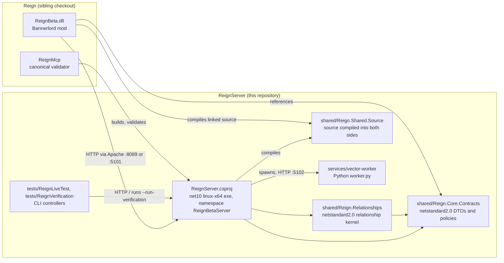

# ReignServer architecture

ReignServer is the local Linux server for the Bannerlord mod Reign. It is one C# net10 executable (`ReignServer`,
`ReignServer.csproj`, linux-x64 only) backed by PostgreSQL, with a managed Python vector worker beside it. The
Bannerlord client (`ReignBeta`, sibling `Reign` repository) talks to it over loopback HTTP; the Control Center UI in
`ui/` is served by the same process. This document describes how the server is composed today, verified against the
code on 2026-11-17, and points at the direction of the current restructuring programme. The client side is described in
the Reign repository's `docs/agent/ARCHITECTURE.md` (in a paired checkout, `../../Reign/docs/agent/ARCHITECTURE.md`).

## Repositories and assemblies

- `ReignServer.csproj` sets `EnableDefaultCompileItems=false` and compiles `src/**/*.cs` plus
  `shared/Reign.Shared.Source/**/*.cs` (linked under `Shared/`). It references the `Reign.Core.Contracts` and
  `Reign.Relationships` projects. `ExcludeCourt=true` removes `src/Modules/Court` and `src/Modules/Spymaster` and
  defines `REIGN_EXCLUDE_COURT`.
- `database/reign_meta.sql`, the default prompts in `prompts/` and a few assets are embedded resources; `ui/`,
  `profiles/`, `services/vector-worker/*.py` and the portrait face-detection model are copied to the output.
- `ReignIncludePrivateVerificationContracts=true` (paired workspace only) runs the `CopyVerificationContracts` target,
  which copies server and client source, UI, docs and GUI files into `verification_contracts/workspace` so the
  source-text contract checks can read them at run time. A public build leaves it disabled.
- `shared/Reign.Core.Contracts` (netstandard2.0, nullable, warnings as errors) holds wire DTOs, protocol constants
  (`Platform/ReignInstallation.SupportedProtocol`, `ReignProtocolHandler.HeaderName`, the terminal action report
  schemas) and game-free policies used by both client and server.
- `shared/Reign.Relationships` is the relationship kernel: deterministic, dependency-free policies
  (`RelationshipCompatibilityPolicy` MBTI compatibility scores, `ArrangedMarriagePolicy`) used by the server's
  Relationships, WorldSimulation and related code. `shared/Reign.Relationships.Tests` holds its xUnit tests.
- `shared/Reign.Shared.Source` is a source package (see its README): a few helpers both sides compile with their
  existing namespaces, so no new runtime assembly or save identity is introduced.
- The server repository owns everything under `shared/`. The client consumes a contract change only after the server
  change has merged.

## Process composition

Everything in `src/` is one `internal static partial class Program` (namespace `ReignBetaServer`): 436 of the 467
`.cs` files under `src/Modules` contribute to it. Module folders are a file layout, not a type or namespace boundary;
any file can call any private static member. Only a few helpers are separate types (for example
`ReignPostgreSqlStorage`, `ReignPostgreSqlDialect`, the `FinalConversationGauntlet*` classes).
`src/Modules/Platform/Program.cs` alone is about 30.8k lines and still contains much of the core dialogue, memory,
character, action and portrait request handling.

`Main` (`Platform/Program.cs`) runs in this order:

1. Commands that run before normal startup. `--import-tavern-native-sources`
   (`Portraits/PreparedTavernPortraitSources.cs`) is checked first. Then a `--run-verification` process is forced
   onto the isolated `ReignValidation` database (`REIGN_VALIDATION_MODE=1`). Then `--activate-only` (which must not
   touch campaign storage) and `--continuity-repair` (which repairs a campaign schema) run and exit.
2. `RunServer`: more one-shot commands (`--author-character-narratives`, `--complete-delete-all`,
   `--generate-profile-library`), then startup housekeeping (data directories, log compaction, Save Sync recovery
   cleanup, prompt templates, default test cases).
3. Self-test and verification commands (see [Verification](#verification-compiled-into-the-server)); each prints
   JSON and exits.
4. Normal start: `ReignPostgreSqlStorage.EnsureInfrastructure()` applies `reign_meta` migrations, the character
   profile library loads, a `TcpListener` binds loopback (port from `--port`, else settings `port`, default 5101),
   then background services start: the priority background scheduler, reputation reason jobs, the continuous
   relationship worker, the world-test rollup worker, memory background jobs, the semantic memory subsystem (vector
   worker), campaign retirement processing and Save Sync optimisation. SIGTERM/SIGINT request a graceful shutdown.

The accept loop hands each connection to `Task.Run(() => HandleClient(client))`, up to
`IngressMaxConcurrentConnections` (256); beyond that the connection is answered busy and closed, never queued.

### Request handling

`HandleClient` (`Platform/Program.cs`) dispatches through the route table in `Platform/RouteTable.cs`. Each module
registers its routes in `src/Modules/<Module>/Program.<Module>Routes.cs`, giving the method, the exact path or prefix
(with its comparison), the handler and the campaign-gate policy, and the first match in registration order wins. Routes
registered as `Legacy(...)` (the `/tests/*` and `/verification/*` routes, the module routers below, and routes whose
router text is pinned by source contracts) are still served by the remaining `if / else if` chain in `HandleClient`,
which ends in the 404 response. `RouteTableContractSelfTests.cs` (interaction architecture suite) checks the table
against the pre-table route inventory, gate decisions and precedence, and checks that every `Legacy` route still has its
chain branch. Per request `HandleClient`:

1. Reads and frames the request in `ReadRequest`, enforcing the ingress limits and access policy before any body is
   buffered, any campaign lock is taken or any route runs.
2. Refuses a client whose `X-Reign-Protocol` header names a different protocol than
   `ReignInstallation.SupportedProtocol`.
3. Calls `EnterCampaignRequestAccess(path)`, then dispatches. A few module routers are called from the legacy chain:
   `TryHandleSpymasterRoute` (Spymaster), `TryHandleArrestRoute` (WorldSimulation), `TryHandleReputationRoute`
   (Reputation). Prefix routes forward to module dispatchers such as `ChatViewApi`, `NpcLivesApi`,
   `CommunicationApi`, `PartyBanterApi`, `OutfitChangeApi` and `RulerRelationsApi`.
4. Writes the JSON response, logs it, releases the campaign access, deletes any unconsumed upload and returns the
   ingress reservations in `finally`.

Interactive LLM routes are wrapped in `RunInteractiveRequest(...)`, which counts and traces in-flight interactive
requests; background work checks `InteractiveRequestActiveOrRecent` and defers while one is active or recent.

### Ingress limits

Defined beside `ReadRequest` in `Platform/Program.cs`: request line 8 KiB, headers 64 KiB and 128 fields, identity
headers 256 chars, JSON body 64 MiB, support bundle 8 MiB, view-insertion ack 16 KiB, campaign upload up to the
backup expanded limit, 30 s idle and header budgets, a body budget of 60 s plus 1 MiB/s, 256 concurrent connections,
and 128 MiB of buffered JSON shared across all connections. Repeated framing or trust headers are refused.
`PublicIngressRoutes` (`/health`, `/`, `/index.html` and the two logo assets) stay public; other routes pass
`IngressAccessRefusal`. Apache on 8089 and direct local tools on 5101 both arrive at this one listener.

### CampaignDataGate and lock order

`CampaignDataGate` is a process-wide `ReaderWriterLockSlim` (no recursion):

- Ordinary requests take a read lease in `EnterCampaignRequestAccess` and record a `CampaignRequestLease` with the
  current `CampaignReplacementGeneration`, so work started before a campaign replacement can detect it.
- Exempt (no lease): `/health`, the Control Center shell and assets, `/api/shutdown`, `/save-sync/*`,
  `/api/save-sync/*`, the campaign export/import/delete/delete-all/cleanup routes, `/tests/*` except `/tests/live*`,
  and `/verification/*`. The exempt routes that change campaigns take the write lock themselves: Save Sync register,
  load and finalize (`Persistence/SaveSync.cs`) and the campaign backup operations (`Persistence/CampaignBackups.cs`).
- The exemptions are declared on the routes (`.WithoutCampaignGate()`) and as exempt areas (`CampaignGateExemptArea`) in
  the module route files; `EnterCampaignRequestAccess` asks the route table. They apply to the path for every method,
  registered or not.

Documented lock order, outermost first: `CampaignDataGate`, then `CampaignBackupMutationLock`, then
`DeleteAllScheduleLock` (innermost; never held across I/O or waits). Cold per-campaign schema initialisation takes
`FileLock` (also exposed as `SettingsSaveGate`) before `CampaignSchemaLock`; `OpenCampaignConnection` throws if
the reverse order is attempted. Other module-local lock orders are documented in comments at their call sites (for
example `Dialogue/PlayerActionIntents.cs`, `Relationships/WorldRelationshipModel.cs`, `Platform/VerificationLab.cs`).

## Storage

PostgreSQL is the only database (Npgsql). `ReignPostgreSqlOptions.FromEnvironment()` reads `REIGN_DB_*`; the product
database is `reign` and validation runs use `ReignValidation`.

- `reign_meta` schema (`database/reign_meta.sql`, embedded): `storage_version`, `campaign_registry`,
  `save_sync_snapshots`, `migration_runs`, the `final_gauntlet_*` controller tables (kept outside campaign schemas so
  a Save Sync rollback does not erase them) and helper functions such as schema cloning. Startup applies it in one
  transaction under `pg_advisory_xact_lock`; `RequiredDatabaseSchemaVersion` (currently 2) must match, and a newer
  database is refused. `/health` reports the applied and required versions.
- One schema per campaign: `reign_campaign_<hash>` (`CampaignSchemaName`).
  `ReignPostgreSqlStorage.OpenCampaignConnection` creates and registers it in `campaign_registry` on first use and
  sets `search_path` to the campaign schema, `reign_meta`, `public`, so module SQL uses unqualified table names.
- Save Sync snapshots: `reign_save_<hash>` schemas recorded in `reign_meta.save_sync_snapshots`, created by
  `CloneCampaignToSnapshot` and restored transactionally by `RestoreCampaignSnapshot`. Campaign JSON files, portraits
  and vectors follow the policy in [docs/server/SAVE_SYNC.md](server/SAVE_SYNC.md).
- Per-campaign tables are created lazily. The first `Program.OpenCampaignConnection` for a campaign runs the core
  `EnsureMemorySchema`, `EnsureCategorizedMemorySchema`, `EnsureWorldHistorySchema` and `EnsureSemanticMemorySchema`
  under the schema locks and caches the result (`CampaignSchemaReady`, checked against `schema_meta`). Every other
  module calls its own `Ensure<Feature>Schema(connection)` when a route first needs it, with
  `CREATE TABLE IF NOT EXISTS` DDL and `schema_meta` revision markers (`IsPostgreSqlComponentSchemaReady`). There are
  about 255 `CREATE TABLE` statements in 88 source files. Each module README lists the tables it creates.
- Files under the data root (`REIGN_DATA_ROOT`, else `data/` beside the executable): `settings.json`, prompts,
  logs, campaign folders, Save Sync stores and vectors. Secrets go through `LinuxSecretVault` /
  `SettingsSecretVault`; shared provider keys come from the global key bridge (`Platform/GlobalKeyBridge.cs`).

## Verification compiled into the server

The shipped server contains its own test system. It is not a separate test project:

- Self-test suites are static `Run*SelfTests` / `Run*Tests` / `Run*Checks` methods in `*SelfTests.cs`,
  `*Tests.cs`, `*ContractTests.cs`, fixture and replay files inside each module folder. Some product types expose
  `*ForTests` hooks used only by these suites.
- `Platform/VerificationLab.cs` aggregates them into tiers (`quick`, `offline`, `live-llm`, `game`, `all`) and named
  suites (`--suite`, for example `contracts`, `pipeline`, `memory_precision`, `government`, `spymaster`,
  `social_reputation`, `campaign_command`, `rebellion`, `shadow_world`, `long_run`, `provider_faults`,
  `war_economy_options`, `interaction_architecture`, `baselines`). `Platform/ArchitectureSelfTests.cs` holds
  architecture and source-text contract checks.
- Command-line entry points in `Main`/`RunServer`: `--run-verification` (with `--tier`, `--suite`, `--seed`,
  `--repeat`, `--fail-fast`, `--json`), `--cancel-verification`, `--run-tests`, and about 25 targeted flags such as
  `--run-diplomacy-tests`, `--run-world-history-tests`, `--run-world-history-stress-tests`,
  `--run-rebellion-tests`, `--run-world-test-tests`, `--run-social-balance-harness-tests`, `--run-court-tests`,
  `--run-trait-percentage-tests`, `--run-motive-conversation-tests`, `--run-sovereign-demeanor-provider-tests`,
  `--run-prompt-caching-tests`, `--run-conversation-scene-state-tests`, `--run-rumor-tests`,
  `--run-relationship-tests`, `--run-pregnancy-choice-tests`, `--run-notable-mbti-tests`,
  `--run-relationship-simulation-tests`, `--run-save-sync-tests`, `--run-character-editor-tests`,
  `--run-portrait-derivative-tests`, `--run-shared-portrait-generation-tests` and
  `--run-portrait-provider-adapter-tests`.
- HTTP test routes are part of the router: `/verification/*`, `/tests/*` (test cases, NPC and party dialogue audits,
  the final conversation gauntlet, live interaction tests, campaign-command and social-balance harnesses, replay
  corpus) and a few module routes such as `/court/tests`, `/rebellions/tests`, `/world-history/tests`,
  `/world-test/tests` and `/arrests/test/contracts`.
- `tests/ReignVerification` is a thin CLI that refuses to run outside the isolated validation environment and
  forwards to `ReignServer.dll --run-verification`. `tests/ReignLiveTest` is the live-test controller used against a
  running game; its feature folders mirror server modules. See [docs/server/VerificationLab.md](server/VerificationLab.md).
- Never run these directly. All builds and tests go through the canonical Reign MCP validator in the paired client
  checkout (see `AGENTS.md`).

## Vector worker

`services/vector-worker/worker.py` is a local HTTP service (default loopback port 5102) for semantic memory:
FastEmbed ONNX `BAAI/bge-small-en-v1.5` embeddings with local Qdrant, ColBERT late-interaction discovery, memory
selection/reranking and dialogue claim validation helpers. The server owns its lifetime: the semantic memory
subsystem (`Dialogue/SemanticMemory.cs`) starts it with `REIGN_VECTOR_PYTHON` against the data directory, monitors
`/health`, and stops it on shutdown. When semantic retrieval is unavailable, memory retrieval falls back to
PostgreSQL full-text search. See
`services/vector-worker/README.md`.

## Linux / WSL deployment

The server runs in its own `ReignServer` WSL distro (Debian):

- `scripts/reignctl` (installed to `/usr/local/bin/reignctl`) owns the lifecycle: `start`, `stop`, `status`,
  `prepare` (pinned dependencies and models), `activate` / `rollback`, `rollback-list`, `repair-permissions`,
  `configure-web` and `global-keys-enroll`. Public `start`/`stop` delegate to `reignserver.service`
  (`scripts/reignserver.service`), whose ExecStart/ExecStop call back into `reignctl`.
- `scripts/reign-control.py` is the Apache CGI behind the Control Center's service controls; `scripts/reign_versions.py`
  manages retained runtime versions; `scripts/install-reign-control.sh` installs these with recoverable begin, restore
  and commit steps.
- Apache exposes port 8089 and forwards to the server on loopback 5101; PostgreSQL uses 5432.
- Source lives in `/var/www/html/ReignServer`, retained executables in `runtime/` (`runtime/current` is the active copy),
  persistent data in `data/`.
- `scripts/Build-Linux.py` builds the public Linux artifact; `scripts/Deploy-LocalWsl.ps1` deploys a validated
  artifact locally. The full procedure is in `AGENTS.md` and `scripts/skills/reign-server-wsl-deploy`.

## Modules

Each folder under `src/Modules` has a README listing its routes, the tables it creates, its self-test suites and its
dependencies on other modules.

| Module | Role |
|---|---|
| [Platform](../src/Modules/Platform/README.md) | `Program.cs` entry point and router, settings, providers, Codex runtime, diagnostics, VerificationLab |
| [Persistence](../src/Modules/Persistence/README.md) | PostgreSQL storage, `reign_meta`, campaign backups, Save Sync |
| [Characters](../src/Modules/Characters/README.md) | identity, character editor, narratives, NPC lives, notables, tavern house |
| [Dialogue](../src/Modules/Dialogue/README.md) | conversation pipeline, memory, prompts, gossip, communications, final gauntlet |
| [Relationships](../src/Modules/Relationships/README.md) | relationship director and lifecycle, MBTI, correspondence, family, rulers |
| [Reputation](../src/Modules/Reputation/README.md) | rumors, social and court reputation, public standing |
| [Diplomacy](../src/Modules/Diplomacy/README.md) | world diplomacy director, political pressure, clan accords |
| [Government](../src/Modules/Government/README.md) | government speaker, hearing and crown-decision dialogue |
| [Court](../src/Modules/Court/README.md) | court sessions, dockets, ambassadors, castle chat, family chambers |
| [Spymaster](../src/Modules/Spymaster/README.md) | spymaster office routes |
| [Rebellion](../src/Modules/Rebellion/README.md) | rebellion director and negotiations |
| [WorldSimulation](../src/Modules/WorldSimulation/README.md) | world history, world test, campaign commands, social events, arrests, live tests |
| [Portraits](../src/Modules/Portraits/README.md) | portrait generation and providers, chat view, outfits, shared portraits |

## Rules every change keeps

- The wire is a contract: route, method, headers and JSON shape stay compatible unless a compatible server change
  lands first. New capability fields are additive.
- Hold the documented lock order; never take `CampaignDataGate` inside another campaign or backup lock.
- Every new campaign table needs its `Ensure*Schema` call on the paths that use it, and must be covered by Save Sync
  (it lives in the campaign schema unless it is controller state).
- Optional providers, the vector worker and other services fail cleanly when absent.
- Build and test only through the canonical validator.

## Direction (2026-11 restructuring programme)

These are planned, one reviewed PR at a time and without behaviour change. None of them exists yet except the partial CI noted in step 7 and the partial route table in step 2; update this
document in the same PR as any step that lands.

1. A verification build flavour: `*SelfTests*`, VerificationLab, test routes and the `--run-*` flags compiled only
   into a verification build (using a csproj condition like `ExcludeCourt`), with the validator building that flavour.
2. A route table: per-module route registrations (method, path, handler, gate policy) replace the `HandleClient`
   chain, and gate exemptions are declared on the routes instead of in a separate list. Partly landed: the table and
   gate declarations exist and serve most routes; the `Legacy(...)` routes still use the chain.
3. Shared helpers (`ReadString`, `TestDict`, `QuerySql`, `ExecuteSql` and similar) move to a static `ServerCore`.
4. The `partial class Program` is split per module into `<Module>Service` and `<Module>Store` classes, leaf modules
   first.
5. Per-campaign versioned migrations: each module's `Ensure*` DDL becomes ordered migrations under one runner,
   following the `reign_meta` pattern, and runtime `Ensure*` calls leave hot paths.
6. Typed request and response DTOs in `Reign.Core.Contracts` for client-facing routes, module by module.
7. CI: extend the existing `.github/workflows/reign-channels.yml` (today it verifies the promotion path and builds
   the public Linux server with `scripts/Build-Linux.py`) to run the server tests and MCP tests.
